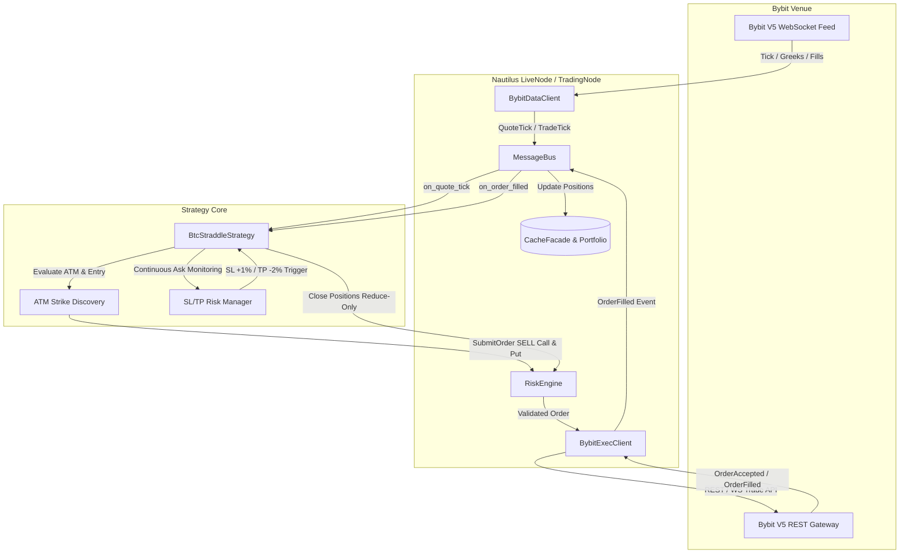

# BTC Options Straddle – NautilusTrader Trading System

A quantitative trading implementation of a **BTC At-The-Money (ATM) Short Straddle** strategy utilizing the high-performance **NautilusTrader** event-driven framework and connected to **Bybit** (Testnet).

This project fulfills both **Level 1 (Naked Straddle Execution)** and **Level 2 (Automated Risk Management)**, and includes an end-to-end deterministic simulation harness for walk-through demonstrations.

---

## 1. Project Overview & Strategy Logic

A **Short Straddle** is a delta-neutral, volatility-selling strategy constructed by simultaneously selling:
1. One **ATM Call option**
2. One **ATM Put option**

Both options share the **same strike price** and the **same expiration date**.

### Strategy Stages:
* **Level 1 (Naked Straddle Execution):**
  * Discovers active BTC options from Bybit.
  * Queries underlying reference price and selects the nearest ATM strike.
  * Identifies matching Call and Put contracts.
  * Simultaneously submits SELL market orders for both legs.
  * Tracks order lifecycle (`Submitted` $\to$ `Accepted` $\to$ `Filled`) and position state.
* **Level 2 (Automated Risk Management):**
  * Continuously evaluates top-of-book **Ask** quotes for buyback valuation:
    $$\text{Combined Buyback Cost} = \text{Ask}_{\text{Call}} + \text{Ask}_{\text{Put}}$$
  * **Stop-Loss (+1%):** If the combined buyback premium increases by $\ge 1\%$ from entry, immediately closes both positions.
  * **Take-Profit (-2%):** If the combined buyback premium decreases by $\ge 2\%$ from entry (volatility crush / theta decay), immediately buys back and closes both positions.
  * **Execution Asymmetry & Race Condition Guard:** Handles partial fills, leg failures, and duplicate exit triggers.

---

## 2. Architecture & Event-Driven Lifecycle



---

## 3. Directory Layout

```
trading_systems/
├── config/
│   ├── __init__.py
│   └── settings.py              # Environment variable loading & defaults
├── strategy/
│   ├── __init__.py
│   ├── straddle_config.py       # BtcStraddleConfig (frozen StrategyConfig)
│   └── straddle_strategy.py     # BtcStraddleStrategy (Core Level 1 + Level 2 logic)
├── scripts/
│   ├── __init__.py
│   ├── run_simulation.py        # Self-contained zero-network simulation (SL & TP scenarios)
│   ├── run_bybit_testnet.py     # Live Bybit Testnet runner via TradingNode
│   ├── verify_bybit_account.py  # Diagnostic tool for Bybit API, UTA status & active options
│   └── interactive_demo.py      # Step-by-step interactive CLI presentation demo
├── tests/
│   ├── __init__.py
│   └── test_straddle.py         # Complete unit test suite (strikes, SL/TP math, guards)
├── .env.example                 # Example Bybit Testnet credentials
├── requirements.txt             # Python dependencies
└── README.md                    # Complete documentation & Walkthrough Q&A
```

---

## 4. Setup & Installation

### Prerequisites
* Python 3.11 (recommended) or 3.10
* Virtual environment (`.venv`)

### Installation Steps
```bash
# 1. Clone/navigate to repository
cd trading_systems

# 2. Create virtual environment using Python 3.11
python3.11 -m venv .venv
source .venv/bin/activate

# 3. Install dependencies
pip install -r requirements.txt

# 4. Configure Bybit Testnet credentials (Optional for simulation, required for live testnet)
cp .env.example .env
# Edit .env with your Bybit Testnet API key and secret
```

---

## 5. Execution & Verification

### A. Run Self-Contained Simulation (Recommended for Walkthrough)
To demonstrate the complete strategy lifecycle without network dependencies or illiquid testnet order books, execute:
```bash
source .venv/bin/activate
python scripts/run_simulation.py
```
This runs two deterministic backtest scenarios through NautilusTrader's matching engine:
1. **Scenario 1 (Take-Profit):** Straddle entered at \$4,900.00 combined premium. Volatility decays, buyback ask drops to \$4,760.00 (-2.85%), triggering automated Take-Profit and closing both legs for a realized gain (+115 USDC).
2. **Scenario 2 (Stop-Loss):** Straddle entered at \$4,900.00. Volatility spikes, buyback ask expands to \$5,000.00 (+2.04%), triggering automated Stop-Loss and liquidating positions.

### B. Run Live Bybit Testnet Node
```bash
source .venv/bin/activate
python scripts/run_bybit_testnet.py
```

---

