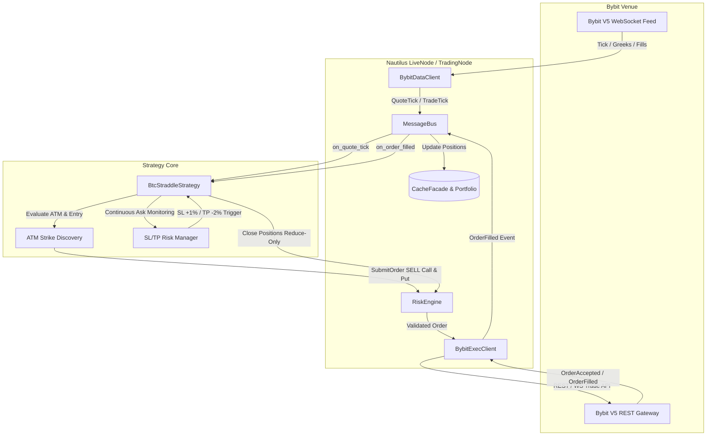

# BTC Options Straddle – NautilusTrader Trading System

A quantitative trading implementation of a **BTC At-The-Money (ATM) Short Straddle** strategy utilizing the high-performance **NautilusTrader** event-driven framework and connected to **Bybit** (Testnet).

This project fulfills both **Level 1 (Naked Straddle Execution)** and **Level 2 (Automated Risk Management)**, and includes an end-to-end deterministic simulation harness for walk-through demonstrations.

---

## 1. Project Overview & Strategy Logic

A **Short Straddle** is a delta-neutral, volatility-selling strategy constructed by simultaneously selling:
1. One **ATM Call option**
2. One **ATM Put option**

Both options share the **same strike price** and the **same expiration date**.

### Strategy Stages:
* **Level 1 (Naked Straddle Execution):**
  * Discovers active BTC options from Bybit.
  * Queries underlying reference price and selects the nearest ATM strike.
  * Identifies matching Call and Put contracts.
  * Simultaneously submits SELL market orders for both legs.
  * Tracks order lifecycle (`Submitted` $\to$ `Accepted` $\to$ `Filled`) and position state.
* **Level 2 (Automated Risk Management):**
  * Continuously evaluates top-of-book **Ask** quotes for buyback valuation:
    $$\text{Combined Buyback Cost} = \text{Ask}_{\text{Call}} + \text{Ask}_{\text{Put}}$$
  * **Stop-Loss (+1%):** If the combined buyback premium increases by $\ge 1\%$ from entry, immediately closes both positions.
  * **Take-Profit (-2%):** If the combined buyback premium decreases by $\ge 2\%$ from entry (volatility crush / theta decay), immediately buys back and closes both positions.
  * **Execution Asymmetry & Race Condition Guard:** Handles partial fills, leg failures, and duplicate exit triggers.

---

## 2. Architecture & Event-Driven Lifecycle



---

## 3. Directory Layout

```
trading_systems/
├── config/
│   ├── __init__.py
│   └── settings.py              # Environment variable loading & defaults
├── strategy/
│   ├── __init__.py
│   ├── straddle_config.py       # BtcStraddleConfig (frozen StrategyConfig)
│   └── straddle_strategy.py     # BtcStraddleStrategy (Core Level 1 + Level 2 logic)
├── scripts/
│   ├── __init__.py
│   ├── run_simulation.py        # Self-contained zero-network simulation (SL & TP scenarios)
│   ├── run_bybit_testnet.py     # Live Bybit Testnet runner via TradingNode
│   ├── verify_bybit_account.py  # Diagnostic tool for Bybit API, UTA status & active options
│   └── interactive_demo.py      # Step-by-step interactive CLI presentation demo
├── tests/
│   ├── __init__.py
│   └── test_straddle.py         # Complete unit test suite (strikes, SL/TP math, guards)
├── .env.example                 # Example Bybit Testnet credentials
├── requirements.txt             # Python dependencies
└── README.md                    # Complete documentation & Walkthrough Q&A
```

---

## 4. Setup & Installation

### Prerequisites
* Python 3.11 (recommended) or 3.10
* Virtual environment (`.venv`)

### Installation Steps
```bash
# 1. Clone/navigate to repository
cd trading_systems

# 2. Create virtual environment using Python 3.11
python3.11 -m venv .venv
source .venv/bin/activate

# 3. Install dependencies
pip install -r requirements.txt

# 4. Configure Bybit Testnet credentials (Optional for simulation, required for live testnet)
cp .env.example .env
# Edit .env with your Bybit Testnet API key and secret
```

---

## 5. Execution & Verification

### A. Run Self-Contained Simulation (Recommended for Walkthrough)
To demonstrate the complete strategy lifecycle without network dependencies or illiquid testnet order books, execute:
```bash
source .venv/bin/activate
python scripts/run_simulation.py
```
This runs two deterministic backtest scenarios through NautilusTrader's matching engine:
1. **Scenario 1 (Take-Profit):** Straddle entered at \$4,900.00 combined premium. Volatility decays, buyback ask drops to \$4,760.00 (-2.85%), triggering automated Take-Profit and closing both legs for a realized gain (+115 USDC).
2. **Scenario 2 (Stop-Loss):** Straddle entered at \$4,900.00. Volatility spikes, buyback ask expands to \$5,000.00 (+2.04%), triggering automated Stop-Loss and liquidating positions.

### B. Run Live Bybit Testnet Node
```bash
source .venv/bin/activate
python scripts/run_bybit_testnet.py
```

---

## 6. Interview Walkthrough: Detailed Answers to the 10 Key Questions

Below are precise, comprehensive technical answers to each question listed in Section 7 of the assignment for the engineering team walkthrough.

### Q1: How does NautilusTrader start and initialize?
* **Architecture:** NautilusTrader initializes a central **`TradingNode`** (or `LiveNode` in v2) that encapsulates the **`NautilusKernel`**.
* **Kernel Components:** The kernel starts an asynchronous event loop (`uvloop`/`asyncio`) and instantiates the core engines:
  1. `DataEngine`: Handles streaming market data feeds and routing.
  2. `ExecEngine`: Manages order routing, fills, and broker communication.
  3. `RiskEngine`: Pre-trade risk evaluation (e.g. position limits, cash/margin validation).
  4. `PortfolioFacade`: Manages account balances, margins, and active positions.
  5. `CacheFacade`: High-speed in-memory store for instruments, orders, and ticks.
  6. `MessageBus`: Low-latency publish/subscribe bus mediating all inter-component communications.
* **Lifecycle:** When `node.build()` is invoked, registered client factories build the venue clients. When `node.run()` is called, the kernel starts all asynchronous background queue tasks and calls `on_start()` on registered strategies.

### Q2: How have you configured the Bybit integration?
* **Data Client:** Configured via `BybitDataClientConfig(testnet=True, product_types=[BybitProductType.OPTION, BybitProductType.LINEAR])`. The `OPTION` product type loads option chains and Greeks; `LINEAR` streams the underlying perpetual/spot price for ATM strike calculation.
* **Execution Client:** Configured via `BybitExecClientConfig(testnet=True, product_types=[BybitProductType.OPTION], api_key=..., api_secret=...)`. Bybit uses the **Unified Trading Account (UTA)** margin mode for cryptocurrency options.
* **Factories:** Attached to the node via:
  ```python
  node.add_data_client_factory(BYBIT, BybitLiveDataClientFactory)
  node.add_exec_client_factory(BYBIT, BybitLiveExecClientFactory)
  ```

### Q3: How does NautilusTrader receive market data?
* The `BybitDataClient` establishes a persistent WebSocket connection to Bybit's V5 market data endpoints (`wss://stream-testnet.bybit.com/v5/public/option`).
* Subscriptions for top-of-book tickers, quote ticks, or order books are sent over the WebSocket.
* When Bybit broadcasts JSON messages, the adapter deserializes them (using fast Rust/`msgspec` parsers) into typed domain objects like `QuoteTick`, `OrderBookDelta`, or `IndexPriceUpdate`.
* These objects are published to NautilusTrader's internal `MessageBus` and dispatched to subscribers.

### Q4: How are BTC option instruments identified and subscribed to?
* **Instrument Symbology:** Bybit option symbols follow the format `BTC-DDMMMYY-STRIKE-C/P[-USDT]`. In NautilusTrader, the adapter appends `-OPTION.BYBIT` (e.g., `BTC-28MAR25-90000-C-OPTION.BYBIT`).
* **Provider Loading:** `BybitInstrumentProvider` queries `/v5/market/instruments-info?category=option&baseCoin=BTC` at startup, parsing each contract into an `OptionContract` instance stored in `self.cache`.
* **Selection Logic:**
  1. The strategy reads `self.cache.instruments(self.venue)` and filters for `underlying == "BTC"`.
  2. It groups options by `expiration_ns` and selects the target expiration series.
  3. It extracts available strike prices and selects the ATM strike minimizing $| \text{strike} - \text{ref\_price} |$.
  4. It extracts the matching `OptionKind.CALL` and `OptionKind.PUT` instruments.
* **Subscription:** The strategy invokes `self.subscribe_quote_ticks(call_id)` and `self.subscribe_quote_ticks(put_id)`.

### Q5: How does the strategy receive market data events?
* Subscriptions made via `subscribe_quote_ticks` register callback routes on the `MessageBus`.
* When a new quote arrives, the data engine invokes the strategy's overridden event handler:
  ```python
  def on_quote_tick(self, tick: QuoteTick) -> None:
      ...
  ```
* The strategy checks `tick.instrument_id` to determine whether the update belongs to the Call leg or the Put leg, updating the corresponding top-of-book ask price in local state.

### Q6: How are orders submitted to Bybit?
* The strategy constructs orders using the built-in `self.order_factory`:
  ```python
  order = self.order_factory.market(
      instrument_id=self.call_id,
      order_side=OrderSide.SELL,
      quantity=self.call_instrument.make_qty(qty),
  )
  self.submit_order(order)
  ```
* `self.submit_order(order)` dispatches a `SubmitOrder` command to the `RiskEngine`.
* Once cleared by risk, the command reaches `BybitExecutionClient._submit_order()`, which formats a Bybit V5 `/v5/order/create` HTTP/WebSocket payload with `category="option"`, side, orderType, and clientOrderId.

### Q7: How does the system know whether an order was accepted or executed?
* **Submission & Acceptance:**
  1. Upon submission, an `OrderSubmitted` event is generated locally.
  2. When Bybit responds acknowledging receipt and assigning an exchange `orderId`, `BybitExecutionClient` emits an `OrderAccepted` event, invoking `on_order_accepted(event)`.
  3. If Bybit rejects the order (e.g. margin shortfall, invalid strike), an `OrderRejected` event invokes `on_order_rejected(event)`.
* **Fills:**
  1. Bybit pushes execution reports over the private WebSocket channel (`execution` stream).
  2. `BybitExecutionClient` parses the trade and emits an `OrderFilled` event containing `last_px`, `last_qty`, and `commission`.
  3. This invokes `on_order_filled(event)` in the strategy, allowing exact calculation of the realized fill prices for both legs.

### Q8: How are positions tracked?
* NautilusTrader tracks positions through the `PortfolioFacade` and `CacheFacade`.
* As `OrderFilled` events occur, the execution engine updates or creates a `Position` object (tracking `signed_qty`, `avg_px_open`, `unrealized_pnl`, `realized_pnl`).
* The strategy lifecycle provides position callbacks:
  - `on_position_opened(event: PositionOpened)`
  - `on_position_changed(event: PositionChanged)`
  - `on_position_closed(event: PositionClosed)`
* The strategy can also query live position state directly using `self.cache.positions_open(...)`.

### Q9: How have you implemented the Stop-Loss and Take-Profit?
* **Combined Premium Tracking:**
  $$\text{Combined Entry Premium} = \text{FillPrice}_{\text{Call}} + \text{FillPrice}_{\text{Put}}$$
* **Continuous Valuation:** On every incoming quote tick (`on_quote_tick`), the strategy updates:
  $$\text{Combined Buyback Cost} = \text{Ask}_{\text{Call}} + \text{Ask}_{\text{Put}}$$
  $$\% \Delta = \frac{\text{Combined Buyback Cost} - \text{Combined Entry Premium}}{\text{Combined Entry Premium}}$$
* **Thresholds:**
  - **Stop-Loss (+1%):** If $\% \Delta \ge +0.01$, premium expanded against our short position. Trigger exit.
  - **Take-Profit (-2%):** If $\% \Delta \le -0.02$, premium contracted in our favor. Trigger exit.
* **Exit Execution:**
  - Sets an atomic flag `self._is_exiting = True` to prevent duplicate triggers from high-frequency ticks.
  - Calls `self.close_all_positions(self.call_id)` and `self.close_all_positions(self.put_id)` to submit buy-to-close reduce-only market orders.

### Q10: What happens when one leg gets executed but the other leg does not? (Leg Risk / Asymmetry)
* **Risk:** In an options straddle, failing to fill both legs breaks delta-neutrality, exposing the book to naked directional gamma/delta risk (e.g. short call exposes to infinite upside).
* **Mitigation Logic (`_handle_execution_failure`):**
  1. The strategy tracks individual leg states (`call_filled`, `put_filled`).
  2. If one leg is rejected, denied, or times out while the other has filled:
     - The strategy logs a critical execution asymmetry alert.
     - Sets `self._is_exiting = True` to cancel any pending entries.
     - Immediately issues a `close_all_positions()` command for the filled leg to liquidate the orphan position and restore a flat risk profile.

